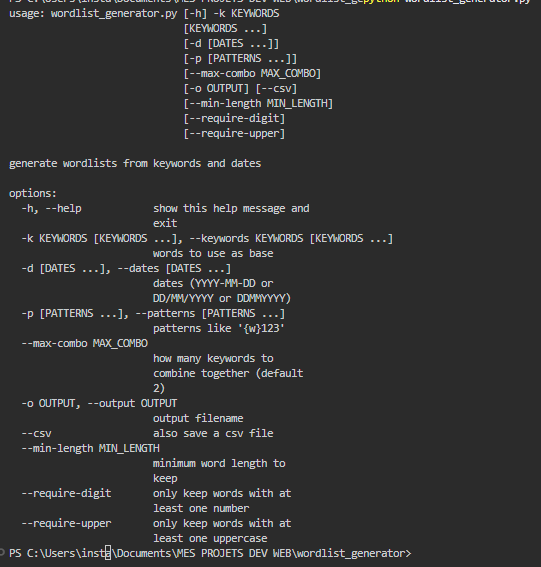
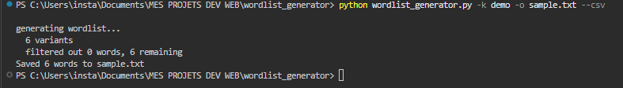
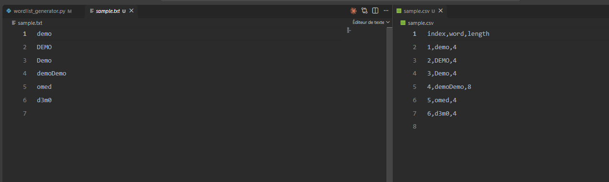
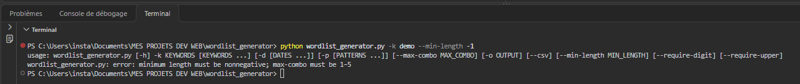
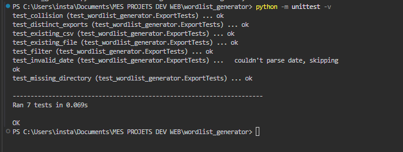

# Wordlist Generator

A small Python command-line utility that generates wordlists from keywords, dates and text patterns, with filtering and TXT/CSV export. This is an educational project for practicing Python and exploring cybersecurity fundamentals in authorized learning environments.

## About the project

I originally built this project by following a tutorial while looking for small exercises to learn Python. I later revisited it to improve its reliability, file handling, input validation and automated testing, while preserving the original program's structure.

## Features

- String transformations, date formatting and text combinations
- Duplicate removal and optional filtering
- TXT and CSV export, with index and length columns in CSV
- Protection against accidentally overwriting existing output files
- Input validation, workload limits and controlled filesystem error messages

## Technologies

Python 3.10+ is the intended baseline; Python 3.13.5 was tested during the review. No third-party packages are required. The program uses `argparse`, `itertools`, `datetime`, `csv`, `pathlib`, `math` and `sys`. Tests use `unittest` and `tempfile`.

## Getting started

Install Python 3, download or clone this repository, and open a terminal in the project folder. Check your installation with `python --version`. On some systems, the command is `python3` instead of `python`.

Display the command-line help:

```bash
python wordlist_generator.py --help
```



### Example using synthetic data

```bash
python wordlist_generator.py -k demo -o sample.txt --csv
```



This demonstration produces six entries in `sample.txt` and a corresponding `sample.csv` file. Use a new output filename if repeating the demonstration: existing output files are intentionally protected.



### Input validation

Invalid numerical arguments are rejected rather than silently accepted.



## Project structure

```text
wordlist-generator/
├── wordlist_generator.py
├── test_wordlist_generator.py
├── README.md
├── .gitignore
└── screenshots/
    ├── 01_cli_help.png
    ├── 02_generation.png
    ├── 03_output_files.png
    ├── 04_error_handling.png
    └── 05_unit_tests.png
```

## Improvements made during the review

| Original limitation | Revised approach |
| --- | --- |
| Filename manipulation could cause TXT and CSV collisions | Use pathlib and check output destinations |
| Existing files could be overwritten | Use exclusive file creation |
| Invalid numerical values were accepted | Validate argument ranges |
| Filesystem errors could cause tracebacks | Handle expected export errors |
| Workloads were unbounded | Check input sizes and estimated entry counts |
| No automated tests | Add seven unittest checks |

The original functional organization and standard-library-only approach were retained to keep the project understandable.

## Testing

```bash
python -m unittest -v
```

The seven tests cover distinct exports, filename collisions, existing TXT and CSV destinations, missing directories, invalid dates and filtering.



All seven passed in my Windows demonstration (0.069 seconds). They also passed in the review environment using Python 3.13.5. These tests do not establish complete coverage.

## Learning objectives

My original goal was to practice Python through a small project. The modernization provides opportunities to study command-line arguments, string processing, functions, file paths, exceptions, input validation and regression testing. The separate export function makes file behavior easier to test without running the entire application.

## Limitations and future improvements

- The program keeps its results in memory. Input limits are conservative educational safeguards, not benchmarked performance guarantees.
- A failed second export can leave a TXT file behind; the two-file operation is not atomic.
- Output is plain text, and command-line arguments may remain in shell history. Do not use sensitive personal information.
- Python 3.10 and macOS compatibility have not been verified. Windows and the Python 3.13.5 review environment have been tested for the documented operations.
- Further boundary tests, clearer CLI messages and additional function documentation would be useful next steps.